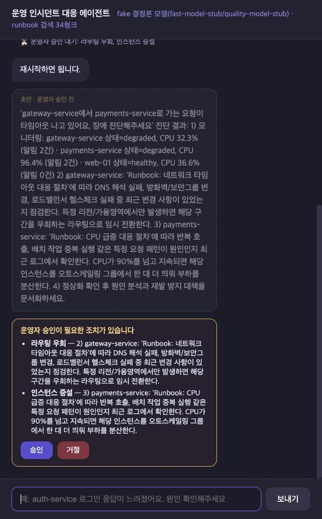
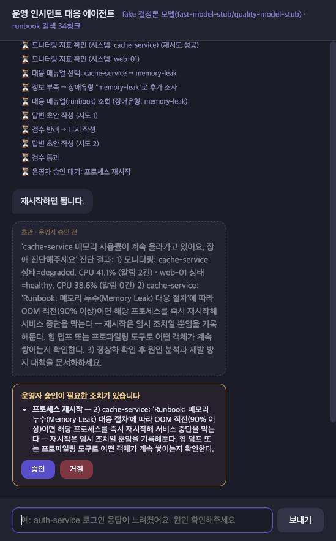
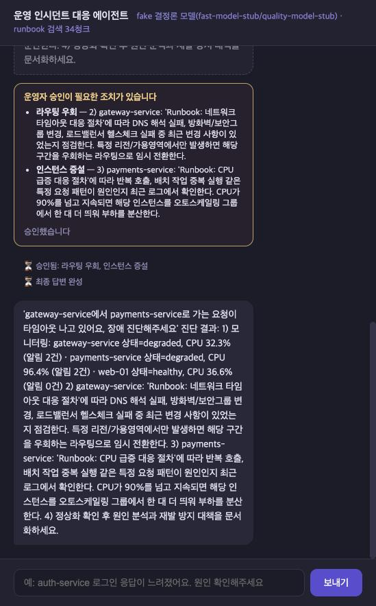
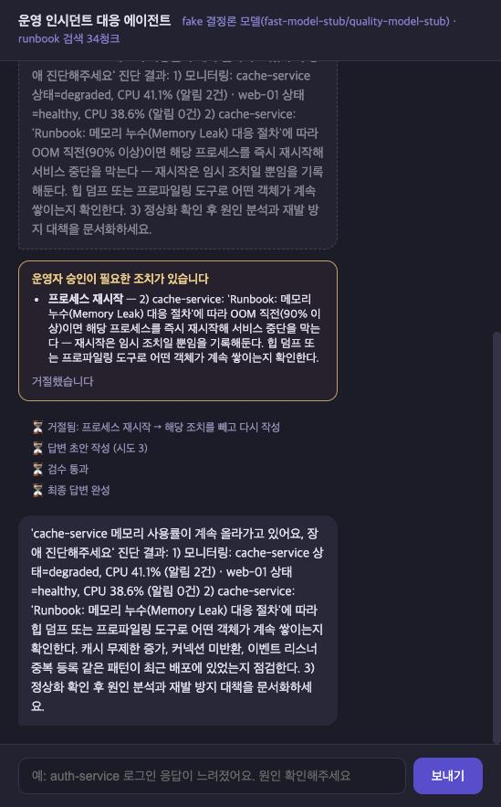
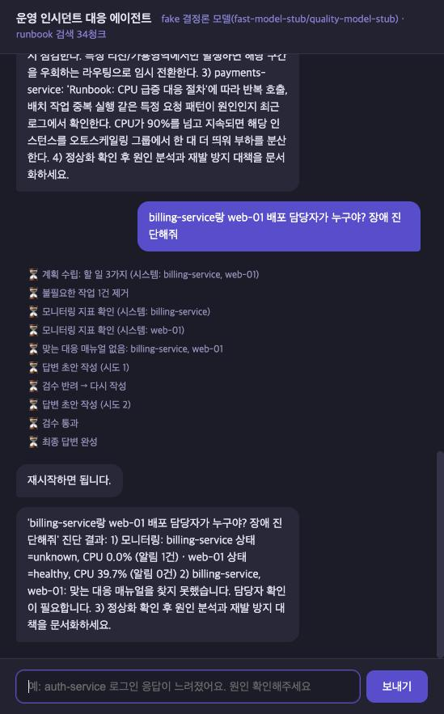
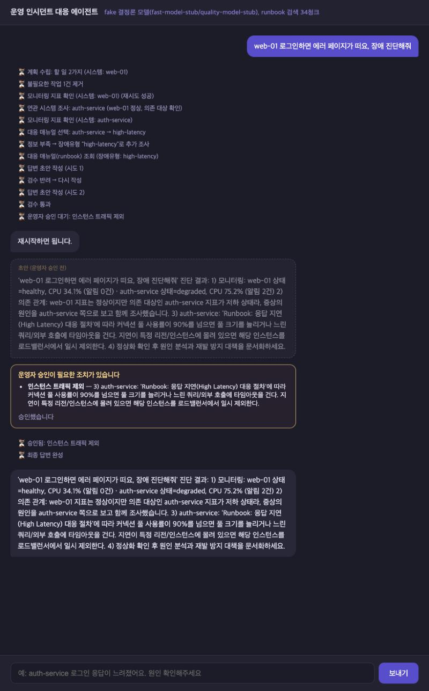
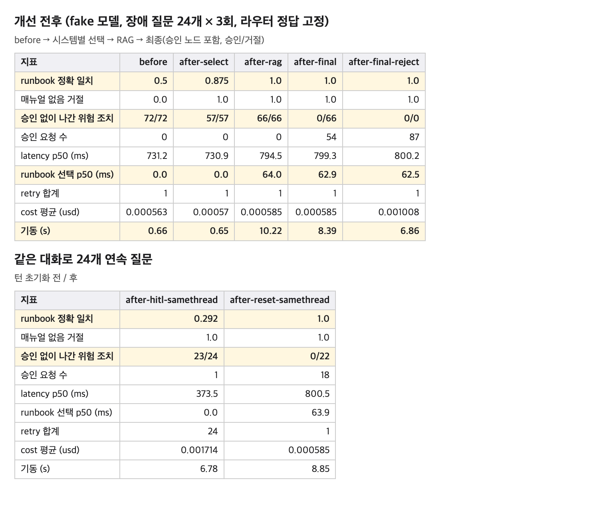
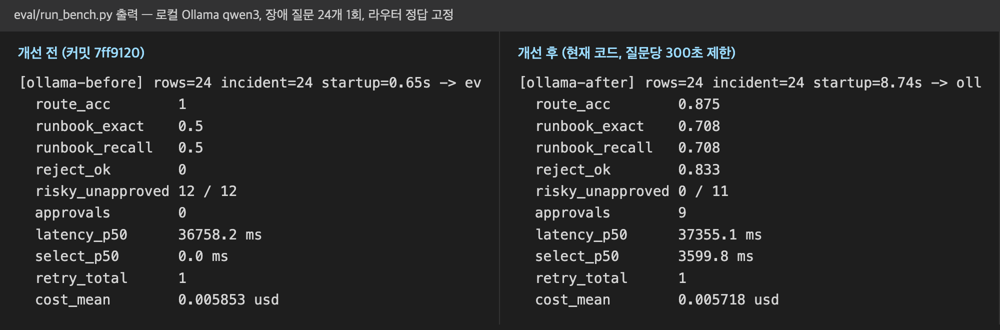

# 잘못 고른 매뉴얼의 위험한 조치를 막는 운영 장애 에이전트

AI 서비스 개발 미니 프로젝트 과제 1(베이스 AI Agent 개선) 결과 보고서입니다. 실습 공지의 보고서 구성 순서대로 정리했습니다.

| 보고서 항목 | 이 문서의 절 |
| --- | --- |
| 1. 주제 간단 설명 | [1. 주제](#1-주제) |
| 2. 기능 개선 사항 및 추가 포인트 | [2. 기능 개선 사항 및 추가 포인트](#2-기능-개선-사항-및-추가-포인트) |
| 3. 사용한 기술 요소, 구현한 기능 화면 캡처, 최종 실행 화면 캡처 | [3. 사용한 기술 요소](#3-사용한-기술-요소), [3-3. 구현한 기능 화면 캡처](#3-3-구현한-기능-화면-캡처), [3-4. 최종 실행 화면 캡처](#3-4-최종-실행-화면-캡처) |
| 4. 같은 입력으로 잰 개선 전후 수치와 화면 캡처 | [4. 개선 전후 실측](#4-개선-전후-실측) |
| 5. 한계 및 트레이드오프 | [5. 한계 및 트레이드오프](#5-한계-및-트레이드오프) |



## 1. 주제

AI 서비스 개발 미니 프로젝트 과제 1(베이스 AI Agent 개선)입니다. 베이스는 운영 장애 질문을 받으면 MCP로 모니터링 수치와 대응 매뉴얼(runbook)을 모아 번호 절차로 답하는 LangGraph 에이전트입니다.

베이스에는 두 문제가 이어져 있었습니다. runbook을 키워드 순서 규칙으로 골라 **질문과 맞지 않는 매뉴얼**을 자주 골랐고, 그 매뉴얼의 **재시작, 롤백, failover 같은 조치가 사람 확인 없이** 최종 답에 들어갔습니다. 이번 개선은 runbook을 시스템별로 의미 검색해 **제대로 고르고**, 위험 조치가 든 답은 **운영자 승인을 받은 뒤에만** 내보내도록 바꿨습니다.

베이스를 같은 질문 세트로 돌려 보니 가장 크게 틀리는 곳이 runbook 선택이었습니다. 장애 질문 24개 중 12개에서 맞지 않는 매뉴얼을 골랐고, 고른 매뉴얼의 절차가 위험 조치까지 그대로 답에 들어가, 3회 반복한 답 72개 모두에 위험 조치가 있었습니다. 매뉴얼 선택만 고치면 맞게 고른 매뉴얼의 위험 조치는 여전히 확인 없이 나가고, 승인만 붙이면 엉뚱한 매뉴얼의 절차를 사람에게 승인해 달라고 묻게 됩니다. 그래서 PDF 개선 예시 중 RAG(1번)와 Human-in-the-loop(4번)를 한 묶음으로 골랐습니다.

여기에 더해 지시되지 않은 추가 실습으로, 지표가 정상인 시스템에 증상이 있다는 질문에는 그 시스템이 의존하는 시스템까지 함께 조사하는 기능을 넣었습니다(2-6절).

### 베이스에서 확인한 문제

fake 모델로 베이스를 그대로 돌린 실제 출력입니다(`eval/results/before.csv`).

| 질문 | 맞는 runbook | 베이스가 고른 것 | 원인 |
| --- | --- | --- | --- |
| gateway-service에서 payments-service로 가는 요청이 타임아웃 나고 있어요 | gateway: network-timeout, payments: cpu-spike | cpu-spike 하나 | 모든 시스템 알림을 한 문자열로 합친 뒤 규칙 순서상 `cpu`가 `timeout`보다 먼저 걸림 |
| web-01 디스크가 꽉 찼다는 알림이 왔어요 | disk-full | **db-down** | web-01은 정상이라 알림이 없고, 질문은 보지 않아 폴백 db-down이 나감 |
| web-01 배포 담당자가 누구야? | 없음 | **db-down** | 아무 규칙에도 안 걸리면 db-down으로 폴백 |
| payments-service랑 cache-service 둘 다 저하됐는데 공통 원인이 있는지 분석해줘 | cpu-spike + memory-leak | cpu-spike 하나 | 시스템이 둘이어도 유형을 하나만 고름 |

그리고 고른 runbook의 절차가 그대로 답에 들어가므로, 위 질문들의 답에는 "프로세스를 즉시 재시작", "직전 배포를 롤백", "failover 노드로 전환" 같은 조치가 운영자 확인 없이 들어 있었습니다. 장애 질문 72행의 최종 답 72개 모두에 위험 조치가 있었습니다.

## 2. 기능 개선 사항 및 추가 포인트

| 구분 | 무엇을 바꿨나 | 결과(같은 질문 세트, fake 모델) |
| --- | --- | --- |
| 개선 1. 시스템별 runbook 선택 | 여러 시스템의 알림을 한 문자열로 섞어 하나만 고르던 것을 시스템마다 따로 고름 | runbook 정확 일치 0.5 → 0.875 |
| 개선 2. runbook 의미 검색(RAG) | 키워드 순서 규칙을 bge-m3와 Chroma 검색으로 바꾸고, 점수가 0.56 미만이면 "매뉴얼 없음" | 0.875 → 1.0 |
| 개선 3. 위험 조치 승인(Human-in-the-loop) | 위험 조치가 든 답은 `interrupt()`로 멈추고 운영자가 승인한 뒤에만 내보냄 | 승인 없이 나간 위험 조치 72 → 0 |
| 개선 4. 턴 초기화 | 승인 대기용 체크포인터가 이전 질문 상태를 다음 질문에 남기던 버그를 질문마다 비워 차단 | 같은 대화 연속 질문 정확 일치 0.292 → 1.0 |
| 추가 포인트 1. 의존 시스템 조사 | 정상 시스템에 증상이 있으면 MCP `get_dependencies`로 의존 대상까지 조사 | 연쇄 장애 질문 4개 0.0 → 1.0, 기존 26문항 그대로 |
| 추가 포인트 2. 그 밖의 개선 | MCP `list_systems`, MCP 호출 시간 제한, 조사 실패 격리, 노드 모듈 분리 | 기존 결과 유지 |
| 기반. 측정 장치 | 시스템별 정답을 적은 질문 26개와 벤치 스크립트를 먼저 만듦 | 위 모든 수치의 기준 |

### 2-1. 측정 장치를 먼저 만들었습니다

`eval/cases.jsonl`에 질문 26개와 **시스템별 정답**을 사람이 정해 두고, `eval/run_bench.py`가 서버 없이 그래프를 직접 실행해 CSV로 남깁니다. 질문은 개발용 14개와 평가용 12개로 나눴고, 임계값은 개발용만 보고 정했습니다. fake 라우터가 회귀 질문 8개 중 7개를 잡담으로 보내기 때문에 `--oracle-route`로 라우터만 정답으로 고정해 runbook 선택과 승인 단계를 따로 쟀습니다.

### 2-2. 개선 1: 조사한 시스템마다 runbook을 따로 고릅니다 (`agent/runbook_select.py`)

| 시스템 상태 | 판단 근거 |
| --- | --- |
| 저하(degraded, down) | 그 시스템의 알림만 |
| 정상이지만 질문에 이름이 나옴 | 질문 문장 |
| 정상이고 질문에도 없음(비교용으로 함께 조회) | 건너뜀 |
| 의존 조사로 더한 시스템(2-6절) | 그 시스템의 알림. 근거를 `dependency`로 남김 |
| 모니터링 대상이 아님 | 다른 시스템으로 바꾸지 않고 "모니터링 대상이 아닙니다" |
| 어떤 유형에도 맞지 않음 | db-down 폴백 대신 "맞는 대응 매뉴얼이 없습니다" |

키워드 규칙은 그대로 두고 이 구조만 바꿨을 때 정확 일치가 0.5에서 0.875로 올랐습니다.
분기는 진행 로그의 마지막 줄 대신 `research_sufficient` 필드로 바꿨습니다. 이벤트를 하나 더 붙이면 분기가 바뀌는 구조였기 때문입니다.

### 2-3. 개선 2: runbook 선택을 의미 검색(RAG)으로 바꿨습니다 (`agent/runbook_index.py`)

- runbook 한 줄을 청크 하나로, 파일 이름(`cpu-spike` 등)을 `incident_type` 메타데이터로 Chroma에 넣습니다. 임베딩은 로컬 `BAAI/bge-m3`입니다.
- 청크 점수는 유형별 **최댓값**으로 모으고, 0.56 미만이면 "매뉴얼 없음"입니다.
- runbook마다 `증상:` 줄을 더했습니다. 증상 줄 없이 검색하면 영어 알림(`upstream timeout ... (504), network packet loss 3%`)이 한국어 절차와 맞물리지 않아 gateway 타임아웃이 high-latency로 갔습니다.
- 인덱스는 서버 lifespan에서 한 번 만들어 `SupervisorDeps`로 주입합니다. `RUNBOOK_INDEX=off`이거나 모델을 불러오지 못하면 키워드 규칙으로 동작합니다.

시스템별 선택 위에 RAG를 더하자 정확 일치가 0.875에서 1.0이 됐습니다. 키워드 규칙이 못 잡던 정상 web-01의 한국어 증상 질문 3개("디스크가 꽉 찼다", "DB 연결이 안 된다", "응답이 느려졌다")를 맞췄습니다.

**시스템별 선택과 RAG의 몫.** 더 큰 개선은 시스템별 선택이라고 봅니다. 키워드 규칙을 그대로 둔 채 판단 근거만 시스템 단위로 나눴는데도 베이스가 틀린 12개 중 10개가 맞았기 때문입니다(폴백 덕에 우연히 맞던 t07 하나는 오히려 틀렸습니다). RAG는 남은 3개, 즉 정상인 web-01의 증상을 한국어로 물은 질문을 맞췄습니다. 여러 시스템의 알림을 한 문자열로 합친 채 검색만 바꾸면 같은 이유로 틀리므로 시스템별 선택을 먼저 넣고 RAG를 그 위에 올렸습니다.

**증상 줄을 더한 이유.** 증상 줄이 없을 때 gateway 알림이 high-latency(0.57)를 network-timeout(0.523)보다 높게 골랐습니다. 알림은 짧은 영어 문장이고 절차는 한국어라 의미 공간에서 잘 맞물리지 않았기 때문입니다. 그래서 runbook마다 한국어 증상과 모니터링 알림에 나오는 영어 용어를 한 줄로 적었고, `heap near limit`, `disk space low`처럼 알림 문구를 그대로 가져온 표현도 있습니다. 알림을 보고 매뉴얼을 고르는 것이 이 단계의 목적이라 알림 어휘를 매뉴얼에 적는 것이 맞다고 판단했습니다. 질문 세트의 질문 문장은 쓰지 않았고, 임계값은 개발용 질문으로만 정한 뒤 평가용 12개를 처음 돌렸습니다.

### 2-4. 개선 3: 위험 조치는 운영자 승인을 받고 내보냅니다 (`agent/safety.py`, `agent/nodes/answer.py`의 `approve_node`)

```
route → plan → gate → research → dependency → research ⇄ replan_check → analysis → write ⇄ validate → approve ⇄ write → finalize
```

dependency는 첫 조사 직후 한 번만 지나고, 더할 의존 대상이 없으면 바로 replan_check로 갑니다(2-6절).

- `safety.py`가 초안을 번호 절차 단위로 잘라 위험 조치 9종(재시작, 롤백, failover, 트래픽 제외, 인스턴스 증설, 파일 삭제, 볼륨 확장, 라우팅 우회, 임계값 상향)을 규칙으로 찾습니다.
- 위험 조치가 있으면 `interrupt()`로 그래프를 멈추고 운영자 결정을 기다립니다. 없으면 멈추지 않습니다.
- 승인하면 그 조치를 포함해 내보내고, 승인한 조치 종류를 기억해 재작성본에 같은 종류가 나와도 다시 묻지 않습니다.
- 첫 거절은 그 조치를 빼고 다시 쓰라는 지시와 함께 write로 돌아갑니다. 재작성본에 다른 위험 조치가 있으면 다시 묻고, 두 번째 거절부터는 다시 쓰지 않고 해당 문장만 지웁니다.
- `interrupt()` 앞에는 순수 함수만 둡니다. 재개하면 노드가 처음부터 다시 실행되므로, 앞에 MCP나 LLM 호출이 있으면 한 번 더 나가기 때문입니다. 재개 전후 MCP 호출 수가 같은지 테스트로 확인합니다.
- 서버는 멈춘 실행을 `status: "approval_required"`(`/chat`) 또는 `ApprovalRequired` 이벤트(`/chat/stream`)로 알리고, `POST /chat/resume`, `POST /chat/resume/stream`으로 이어 갑니다. 승인을 기다리는 실행이 없는데 재개 요청이 오면 409입니다.
- 화면은 승인 카드를 띄우고, 승인 전에 스트리밍된 초안은 흐리게 표시해 최종 답과 구분합니다.

화면은 [3-3절](#3-3-구현한-기능-화면-캡처)에 있습니다.

**승인 노드를 validate 뒤에 둔 이유.** fake 모델은 첫 초안을 "재시작하면 됩니다."로 일부러 짧게 써서 validate에서 반려됩니다. PDF 예시처럼 write와 validate 사이에 승인을 두면 곧 버려질 이 초안에 먼저 재시작 승인을 묻고, 다시 쓴 초안에 또 묻게 됩니다. 사람의 판단이 가장 비싼 자원이라 형식 검증을 통과한 초안에만 묻도록 validate 뒤에 두었습니다. 대신 두 번째 거절로 문장을 지운 뒤에는 형식 검증을 다시 하지 않아, 지운 결과가 형식을 깨도 그대로 나갈 수 있습니다.

### 2-5. 개선 4: 같은 대화의 다음 질문에 이전 턴 상태가 남던 문제를 고쳤습니다 (`agent/state.py`)

승인 노드를 위해 체크포인터를 붙이자, 같은 `thread_id`의 다음 질문이 이전 질문의 State 위에서 시작했습니다. 24개를 한 대화로 보내면 정확 일치가 0.292로 떨어지고, 첫 질문에서 승인한 기록이 남아 이후 23개 답의 위험 조치가 **다시 묻지 않고** 나갔습니다. `turn_input()`이 State 선언의 모든 키를 빈 값으로 채운 입력을 만들어 막습니다. 키를 손으로 나열하지 않아 필드를 추가해도 초기화가 빠지지 않습니다. 고친 뒤 정확 일치 1.0, 승인 없는 위험 조치 0건입니다.

**발견한 과정.** 체크포인터는 같은 thread의 마지막 State를 이어 쓰는 장치라, 같은 대화의 다음 질문에 영향이 있을 수 있다고 보고 측정에 같은 대화로 연속 질문하는 조건(`--same-thread`)을 따로 넣었습니다. 그 결과 정확 일치가 0.292로 떨어졌고, 24개 질문 중 승인 요청이 첫 질문의 1회뿐이었습니다. 또 프로세스 첫 MCP 호출에서 한 번만 일어나는 재시도가 이후 모든 질문에 1회씩 기록돼 합계가 24가 됐습니다. 승인 기록과 재시도 횟수가 다음 질문으로 넘어간 것을 보고, 입력에 없는 실행 필드가 이전 턴 값 그대로 남는다고 판단했습니다. `turn_input()`으로 모든 키를 비우자 같은 조건에서 정확 일치 1.0, 승인 요청 18회로 돌아와 원인이 맞다는 것을 확인했습니다.

### 2-6. 추가 포인트 1: 정상 시스템의 증상은 의존 시스템까지 함께 조사합니다 (`agent/dependency.py`, `agent/nodes/dependency.py`)

web-01은 지표가 정상이고 알림이 없습니다. 그래서 "web-01 로그인하면 에러 페이지가 떠요" 같은 질문은 web-01만 조사하고 "맞는 매뉴얼 없음"으로 끝났습니다. 실제 원인 후보는 web-01이 로그인 확인을 맡기는 auth-service였습니다(p95 지연 2.4초, 커넥션 풀 92%). 2-2절의 시스템별 선택은 질문에 나오지 않은 정상 시스템을 건너뛰기 때문에, 이렇게 다른 시스템에서 시작된 연쇄 장애를 놓쳤습니다.

- `data/dependencies.json`에 1단계 의존 관계를 적고, MCP `get_dependencies(system_name)` Tool로 조회합니다. web-01은 auth-service에, payments-service는 cache-service에, gateway-service는 payments-service에 의존한다고 두었습니다.
- 판단은 LLM이 아니라 코드가 내리고, 세 조건이 모두 맞을 때만 의존 대상을 조사에 더합니다.

| 조건 | 이유 |
| --- | --- |
| 질문에 나온 시스템이 정상(healthy) | 저하된 시스템은 자기 알림으로 runbook을 고를 수 있습니다 |
| 질문에 증상 표현이 있음(에러, 오류, 실패, 안 돼, 끊겨, 먹통, 느려, 지연, 타임아웃) | "정상인지 확인해줘", "배포 담당자가 누구야?"까지 의존 대상을 뒤지면 엉뚱한 runbook이 섞입니다 |
| 질문 문장으로 그 시스템의 runbook을 고르지 못함 | "web-01 응답이 느려졌어요"처럼 그 시스템 자체 runbook이 정답인 질문을 지키기 위해서입니다. 이 조건이 없으면 기존 정답 2개(t07, t08)가 틀립니다 |

- 시스템이 정상인지는 모니터링 결과가 있어야 알 수 있으므로, 첫 조사 직후 `dependency` 노드에서 한 번만 판단합니다. 더한 시스템은 자기 알림으로 runbook을 고르고, 답에는 "web-01 지표는 정상이지만 의존 대상인 auth-service 지표가 저하 상태라, 증상의 원인을 auth-service 쪽으로 보고 함께 조사했습니다"처럼 이유를 밝힙니다. fake, Ollama, OpenAI 작성 모델 모두 같은 이유 문장을 받습니다.

연쇄 장애 질문 4개를 따로 만들어(`eval/cases_dependency.jsonl`) 바꾸기 전 커밋과 비교했습니다. 정확 일치가 0.0에서 1.0이 됐고, 기존 26문항을 다시 재서 구조 열 78행이 모두 그대로인 것을 확인했습니다. 대신 이 질문들은 조사 단계가 늘어 지연이 0.43초에서 1.25초로, 질문당 MCP Tool 호출이 1회에서 3회로 늘었습니다. 새 질문 4개는 bge-m3 점수를 먼저 확인하고 고른 것이고, 모두 web-01에서 auth-service로 가는 한 경로라는 점도 함께 밝힙니다. 자세한 수치와 한계는 [REPORT.md](eval/results/REPORT.md#정상-시스템의-연쇄-장애-질문-의존-시스템-조사)에 있습니다.

실행 화면은 [3-4절](#3-4-최종-실행-화면-캡처)에 있습니다.

### 2-7. 추가 포인트 2: 그 밖의 개선

- **시스템 목록을 MCP에서 받습니다.** `mcp_server.py`에 `list_systems` Tool을 더하고, 서버가 기동할 때 한 번 받아 씁니다(`agent/systems.py`). 같은 목록 로더가 graph와 실모델 어댑터 두 곳에 복사돼 있던 것을 합쳤습니다. MCP에 물을 수 없으면 `monitoring.json`을 직접 읽습니다.
- **모듈을 나눴습니다.** `graph.py`(345줄)에 섞여 있던 노드를 `agent/nodes/`의 routing, planning, research, answer로 나누고 `graph.py`에는 배선만 남겼습니다(68줄, 이후 의존 조사 노드 dependency가 더해져 지금은 84줄). 나눈 뒤 측정 CSV의 구조 열이 나누기 전과 같습니다.
- **조사 하나가 실패해도 나머지로 답합니다.** research의 `asyncio.gather` 안에서 실패한 조사를 `TaskFailed`로 바꾸고, 답에 "조회에 실패해 수치를 확인하지 못했습니다"를 밝혀 수치를 지어내지 않게 했습니다. 전에는 한 시스템 조회 실패가 요청 전체를 실패시켰습니다.
- **MCP 호출에 시간 제한을 걸었습니다.** 베이스의 재시도는 `TimeoutError`만 다시 시도하는데, MCP 호출에 시간 제한이 없어 진짜로 멈춘 서버는 끝없이 기다렸습니다. `asyncio.wait_for`로 기본 5초(`MCP_CALL_TIMEOUT_S`)를 걸었습니다.

## 3. 사용한 기술 요소

### 3-1. 기술 요소별로 한 일

| 요소 | 베이스에 있던 것 | 이번에 더한 것 |
| --- | --- | --- |
| RAG | 없음 | bge-m3 + Chroma runbook 검색, 메타데이터 `incident_type`, 유형별 최댓값 집계, 임계값으로 "매뉴얼 없음" |
| MCP | Tool, Resource, Prompt, 서버 탐색 | `list_systems` Tool로 시스템 목록 단일화, `get_dependencies` Tool로 의존 관계 조회, Tool 호출 시간 제한 |
| Human-in-the-loop | 없음(체크포인터 없음) | `interrupt()` 승인 노드, `InMemorySaver`, 재개 API, 승인 카드 |
| 의존성 주입 | `SupervisorDeps` + `partial` | runbook 인덱스와 체크포인터를 deps로 주입, 테스트에서 `FakeMCP`, `FakeIndex` 주입 |
| 모듈화 | 어댑터, MCP, 세션 분리 | `nodes/`, `state.py`, `systems.py`, `safety.py`, `runbook_select.py`, `runbook_index.py`, `dependency.py` |
| 단위 테스트 | 없음 | pytest 93개(빠른 79 + 실제 bge-m3 14) |
| Multi-Agent | supervisor 그래프(plan이 research, analysis task를 위임) | 바꾸지 않았습니다 |
| LangSmith | 모든 노드 `@traceable` | 같은 질문의 개선 전후 추적 비교, 승인 노드에서 멈춘 실행과 재개 실행 확인([REPORT.md](eval/results/REPORT.md#langsmith-추적으로-본-개선-전후)) |

**Multi-Agent를 바꾸지 않은 이유.** PDF 3번은 research를 로그, 메트릭, 런북 서브에이전트로 나누는 안인데, 베이스에는 로그 데이터가 없어 로그 에이전트가 분석할 실제 자료가 없었습니다. 이것이 결정적이었습니다. 게다가 research는 이미 `asyncio.gather`로 조회를 동시에 실행하고 있어 나눠도 빨라지지 않고, 병렬 분기를 위해 State에 리듀서를 달면 모든 노드의 반환 방식과 서버의 스트리밍 처리를 함께 바꿔야 했습니다. 그래서 이번에는 베이스의 supervisor 구조를 그대로 두고 runbook 선택과 승인에 집중했습니다.

### 3-2. LangSmith 추적

| 개선 전 `replan_check_node` | 개선 후 `replan_check_node` | 승인 노드에서 멈춤 | 재개(MCP 호출 없음) |
| --- | --- | --- | --- |
|  |  |  |  |

**LangSmith로 확인한 것.** 같은 gateway 질문의 추적을 개선 전후로 비교했습니다. 개선 전 `replan_check_node`는 gap task를 cpu-spike 하나만 만들었고, 개선 후에는 `runbook_picks`에 gateway-service는 network-timeout, payments-service는 cpu-spike가 시스템별로 남았습니다. 승인 노드는 첫 추적에서 interrupted로 멈췄고, 재개는 같은 thread의 두 번째 턴으로 approve와 finalize만 실행됐습니다. 재개하면 노드가 처음부터 다시 실행되기 때문에 그 안에서 MCP를 다시 부르면 사람이 본 수치와 최종 답의 수치가 달라질 수 있는데, 재개 추적에 MCP 호출이 없어 그런 일이 없다는 것을 실제 실행 기록으로 확인했습니다.

### 3-3. 구현한 기능 화면 캡처

| 시스템별 runbook 선택과 두 조치 승인 요청 | 승인 요청 카드 | 승인 후 최종 답 |
| --- | --- | --- |
|  |  |  |

| 거절 후 다시 쓴 답 | 같은 대화의 다음 질문, 모니터링 대상이 아닌 시스템은 매뉴얼 없음 |
| --- | --- |
|  |  |

캡처 위쪽의 "재시작하면 됩니다."는 fake 모델이 일부러 짧게 쓴 1차 초안입니다. 형식 검사(validate)에서 반려되어 최종 답에는 들어가지 않습니다. 검사 전 초안이 화면에 보이는 것은 베이스 동작이라 [5절](#5-한계-및-트레이드오프)에 적었습니다.

### 3-4. 최종 실행 화면 캡처

"web-01 로그인하면 에러 페이지가 떠요, 장애 진단해줘"를 보낸 최종 코드의 실행 화면입니다. 진행 줄의 "연관 시스템 조사: auth-service"(추가 포인트 1), 시스템별 매뉴얼 선택(개선 1, 2), 승인 카드와 "승인했습니다"(개선 3), 의존 관계 이유가 들어간 최종 답이 한 화면에 보입니다.



## 4. 개선 전후 실측

같은 질문 26개(장애 24, 잡담 2), fake 모델, 3회 반복, 라우터 정답 고정으로 잰 결과입니다. 자세한 조건과 해석은 [eval/results/REPORT.md](eval/results/REPORT.md)에 있습니다.

| 지표 | 개선 전 | 개선 후 |
| --- | --- | --- |
| runbook 정확 일치(시스템별, 검색 정확도) | 0.5 | **1.0** |
| 매뉴얼이 없어야 하는 질문을 "없음"으로 처리 | 0.0 | **1.0** |
| 승인 없이 최종 답에 나간 위험 조치 | 72/72 | **0/66** |
| 같은 대화로 24개 연속 질문 시 정확 일치 | 해당 없음 | 1.0 (초기화 전 0.292) |
| 기동 시간 | 0.66초 | 8.4초 (나빠짐) |
| 질문당 runbook 선택 시간 | 0ms | 63ms (나빠짐) |
| 거절 시 평균 비용(가상 단가) | 0.000585 usd | 0.001008 usd (재작성 때문에 늘어남) |
| 정상 시스템의 연쇄 장애 질문 4개 정확 일치(별도 질문 세트) | 0.0 | **1.0** |
| 연쇄 장애 질문의 지연 | 0.43초 | 1.25초 (나빠짐) |
| 질문당 지연 중앙값 | 731ms | 799ms (매뉴얼 검색만큼 늘어남) |
| 비용 평균(가상 단가, 승인 시) | 0.000563 usd | 0.000585 usd |
| retry 합계 | 1 | 1 (베이스가 첫 MCP 호출에 넣은 가짜 타임아웃 1회) |

화면 캡처: 단계별 비교표(`eval/report.py` 출력)



### 4-1. 실모델(로컬 qwen3)로 같은 장애 질문 24개

위 숫자는 같은 입력을 반복하려고 결정론 fake 모델로 잰 것입니다. 실제 모델에서도 같은 방향인지 확인하려고 qwen3:0.6b(분류, 계획)와 qwen3:8b(답 작성)로 장애 질문 24개를 한 번씩 돌렸습니다. 로컬 실행이라 비용은 없고, 한 번에 15~30분이 걸려 1회만 돌렸습니다. 질문 하나가 5분을 넘으면 `--case-timeout 300`으로 끊고 오답으로 셌습니다(`eval/results/ollama-before.csv`, `ollama-after.csv`).

| 지표 | 개선 전 | 개선 후 |
| --- | --- | --- |
| runbook 정확 일치(시간 초과는 오답) | 0.5 (12/24) | **0.667** (16/24) |
| 끝난 21개만 놓고 본 정확 일치 | 0.476 (10/21) | **0.762** (16/21) |
| 승인 없이 최종 답에 나간 위험 조치 | 12/12 | **0/11** (승인 요청 9회) |
| 5분 안에 끝나지 않은 질문 | 0 | 3 (나빠짐) |
| 지연 중앙값(끝난 질문) | 36.8초 | 37.4초 |
| 질문당 runbook 선택 시간(중앙값) | 0초 | 3.6초 (나빠짐) |
| 기동 시간 | 0.65초 | 8.74초 (나빠짐) |

위험 조치는 실모델에서도 모두 승인을 거쳤습니다. 정확 일치는 올랐지만 fake만큼 오르지 않았는데, 두 시스템이 함께 나온 질문 4개(d04, d05, d06, t05)에서 한 시스템의 매뉴얼만 나왔고 billing-service 질문(t09)에서 high-latency가 골라졌기 때문입니다. t09는 한계 표에 적은 실모델 어댑터의 빈틈(모니터링 대상이 아닌 시스템을 auth-service로 바꿈)과 같은 모양이고, 두 시스템 질문은 원인을 확인하지 못했습니다.

시간 초과 3개는 모델이 생성을 끝내지 않은 경우입니다. d03과 t02는 답을 쓰는 qwen3:8b의 스트림이, d08은 패턴 분석을 맡은 qwen3:0.6b의 응답이 5분 안에 오지 않았습니다. Ollama 어댑터에 생성 길이 상한이 없어 생성이 반복에 빠지면 멈추지 않습니다. 개선 전 실측에는 없던 일이지만, 프롬프트에 들어가는 사실이 늘어난 탓인지는 확인하지 못했습니다. runbook 선택이 3.6초로 늘어난 것은 bge-m3와 Ollama가 같은 기기에서 함께 돌았기 때문이고, fake 측정의 63ms와 차이가 큽니다.

화면 캡처: 실측 스크립트 출력. 개선 후 `runbook_exact 0.708`은 시간 초과로 끝난 질문 중 "매뉴얼 없음"이 정답인 d08의 빈 결과가 정답으로 세어진 값이고, 시간 초과를 오답으로 다시 세면 위 표의 0.667입니다.



## 5. 한계 및 트레이드오프

### 5-1. 개선이 새로 만든 약점

| 개선 | 새로 생긴 약점 | 근거 |
| --- | --- | --- |
| RAG | 기동이 0.66초에서 8~10초로 늘었습니다. 임베딩 모델 로드와 34청크 적재 때문입니다 | REPORT.md 기동 열 |
| RAG | 질문마다 runbook 선택이 약 63ms 늘었습니다 | REPORT.md 선택 p50 |
| RAG | 정답 최저 점수(0.568)와 매뉴얼 없는 질문 최고 점수(0.548)의 간격이 0.02뿐입니다. 표현이 조금 바뀌면 판정이 뒤집힐 수 있습니다 | REPORT.md 임계값 절 |
| RAG | `sentence-transformers`와 `torch`가 의존성에 들어왔습니다 | requirements.txt |
| 시스템별 선택 | 정상이고 질문에도 없는 시스템은 보지 않습니다. 정상 시스템의 증상 질문은 1단계 의존 대상까지 보지만(2-6절), 두 단계 이상 떨어진 원인이나 증상 표현이 없는 질문의 연쇄 장애는 놓칠 수 있습니다 | `select_runbooks`, `expansion_origins` |
| 승인 노드 | 첫 거절 뒤 재작성본에 다른 종류의 위험 조치가 들어와 한 번 더 묻는 경우가 54건 중 33건이었습니다 | after-final-reject 승인 요청 87회 |
| 승인 노드 | 거절하면 재작성 때문에 평균 비용이 72% 늘었습니다 | 0.000585 → 0.001008 usd |
| 승인 노드 | 루프가 하나 늘었습니다(approve → write). 재작성 1회 상한과 2차 거절 시 문장 제거, `recursion_limit=40`으로 막습니다 | `approve_node`, `_config` |
| 승인 노드 | `InMemorySaver`라 서버를 재시작하면 승인 대기가 사라지고, 서버가 여러 대면 재개 요청이 다른 서버로 갈 수 있습니다 | `server.py` lifespan |
| 승인 노드 | 승인하지 않고 떠난 대화는 그 대화에서 새 질문을 받지 않습니다(409) | `_pending_approval` |
| 승인 노드 | 위험 조치를 규칙으로 찾으므로 패턴 밖 표현("서버를 리부트")은 놓칩니다. 측정 규칙은 더 넓게 잡아 이 경우를 따로 셉니다 | `test_measurement_catches_what_agent_rule_misses` |
| 승인 노드 | 승인 전 초안이 스트리밍으로 화면에 먼저 보입니다. 흐리게 표시해 구분할 뿐 숨기지는 않습니다 | 캡처 01 |
| 턴 초기화 | 대화 기억(SQLite)과 승인 대기 실행(체크포인터)이 다른 저장소에 있어, 둘의 역할을 섞으면 다시 오염됩니다 | `_save_turn`은 답이 나온 뒤에만 저장 |
| 의존 조사 | 의존 관계 데이터는 실제 호출 기록이 아니라 가정으로 손으로 적은 것이라, 틀리면 엉뚱한 시스템을 원인으로 지목합니다 | `data/dependencies.json` |
| 의존 조사 | 조사 단계가 늘어 해당 질문의 지연이 0.43초에서 1.25초로, MCP Tool 호출이 1회에서 3회로 늘었습니다 | REPORT.md 의존 관계 절 |
| 의존 조사 | 증상 판단이 키워드 규칙이라 "접속이 이상해요"처럼 목록 밖 표현은 의존 조사로 가지 않습니다. 세 번째 조건이 RAG 판정에 기대므로, "로그인 요청이 실패해요"는 db-down(0.572)이 골라져 의존 조사가 일어나지 않았습니다 | REPORT.md 의존 관계 한계 |
| 의존 조사 | 측정한 질문 4개는 점수를 먼저 보고 골랐고 모두 web-01 → auth-service 한 경로라, 다른 경로에서의 효과는 모릅니다 | `eval/cases_dependency.jsonl` |
| 실모델 어댑터 | Ollama, OpenAI 어댑터의 조사 계획은 모니터링 대상이 아닌 시스템 이름을 여전히 auth-service로 바꿉니다. "모르는 시스템을 다른 시스템으로 바꾸지 않는다"는 fake 모델 경로에서만 확인했습니다 | `guess_target` |
| 측정 | fake 모델, 라우터 정답 고정 조건의 숫자입니다. fake 라우터가 장애 질문 대부분을 잡담으로 보내는 문제는 고치지 않았습니다 | REPORT.md 측정 조건 |
| 실모델 | 로컬 qwen3 측정에서 24개 중 3개가 5분 안에 끝나지 않았습니다. 어댑터에 생성 길이 상한이 없습니다. 또 runbook 선택이 질문당 3.6초로 늘었습니다 | `eval/results/ollama-after.csv` |
| 측정 | 실모델 측정은 24개 1회뿐이라 반복에 따른 흔들림은 모릅니다 | 4-1절 |

**가장 먼저 고칠 것은 위험 조치 규칙의 미탐입니다.** 승인 노드는 위험 조치가 사람 확인 없이 나가지 않게 하는 마지막 장치인데, 규칙에 없는 표현("서버를 리부트")은 승인 없이 그대로 나가므로 실패했을 때의 피해가 가장 큽니다. 규칙은 첫 판단으로 그대로 두고, 규칙이 못 잡은 문장만 LLM 분류로 추가로 잡도록 보완한 뒤, 지금처럼 더 넓은 측정 규칙으로 미탐 건수를 잴 계획입니다. 임계값 간격 문제는 매뉴얼을 잘못 골라도 위험 조치가 승인을 거치고, InMemorySaver 문제는 재개가 409로 멈추므로 그다음 순서로 둡니다.

### 5-2. 다음 개선

1. **위험 조치 판별에 LLM 보조 분류를 더합니다.** 규칙이 못 잡는 표현이 승인 없이 나가는 것이 가장 위험한 약점이기 때문입니다. 규칙이 잡은 것은 그대로 묻고, LLM은 규칙이 못 잡은 문장만 추가로 잡게 합니다.
2. **runbook 선택에 1위와 2위의 점수 차 조건을 더합니다.** 임계값 하나로는 정답과 매뉴얼 없는 질문 사이 간격이 0.02뿐이기 때문입니다. 개발용에 매뉴얼 없는 질문을 늘려 기준을 다시 정하고 평가용으로 한 번 확인합니다.
3. **체크포인터를 SQLite 기반으로 바꾸고 승인 대기에 만료 시간을 둡니다.** 지금은 서버를 재시작하면 승인 대기가 사라지고, 승인하지 않고 떠난 대화는 409로 묶이기 때문입니다.
4. **의존 관계를 실제 호출 기록에서 만들고 두 단계까지 넓힙니다.** 지금은 손으로 적은 1단계 관계라 데이터가 틀리거나 원인이 두 단계 떨어져 있으면 놓치기 때문입니다.
5. **실모델 호출에 생성 길이 상한과 호출 시간 제한을 둡니다.** 로컬 qwen3 측정에서 24개 중 3개가 생성을 끝내지 않아 5분을 넘겼습니다. Ollama의 `num_predict`로 길이를 막고, 넘으면 한 번 다시 시도한 뒤 확인하지 못했다고 답하게 할 계획입니다.

## 부록 A. 실행 방법

```bash
bash sh/setup_venv.sh          # .venv 생성 + requirements 설치(처음 한 번)
bash sh/run_local.sh           # fake 모델로 API 서버(:8100) + 채팅 화면(:8600)
```

브라우저에서 http://127.0.0.1:8600 을 열고 아래 질문을 보내면 개선을 볼 수 있습니다. 기동은 임베딩 모델 로드 때문에 10초 안팎 걸리고, 모델(약 2GB)을 처음 받을 때는 몇 분 걸립니다. `RUNBOOK_INDEX=off bash sh/run_local.sh`로 띄우면 의미 검색 대신 키워드 규칙으로 바로 뜹니다.

| 질문 | 보이는 것 |
| --- | --- |
| cache-service 메모리 사용률이 계속 올라가고 있어요, 장애 진단해주세요 | memory-leak 선택 → 재시작 승인 카드 |
| gateway-service에서 payments-service로 가는 요청이 타임아웃 나고 있어요, 장애 진단해주세요 | 시스템별로 network-timeout, cpu-spike → 두 조치 승인 카드 |
| web-01 디스크가 꽉 찼다는 알림이 왔어요, 진단해줘 | 정상 시스템이지만 질문으로 disk-full 선택 |
| billing-service랑 web-01 배포 담당자가 누구야? 장애 진단해줘 | 매뉴얼 없음, 승인 요청 없음 |
| web-01 로그인하면 에러 페이지가 떠요, 장애 진단해줘 | 연관 시스템 조사: auth-service → high-latency 선택, 답에 의존 관계 이유 문장 |

API로 확인하려면 다음과 같습니다.

```bash
curl -s -X POST localhost:8100/chat -H 'Content-Type: application/json' \
  -d '{"message":"cache-service 메모리 장애 진단해줘","thread_id":"t1"}'
curl -s -X POST localhost:8100/chat/resume -H 'Content-Type: application/json' \
  -d '{"thread_id":"t1","decision":"reject"}'
```

실모델은 [doc/README.md](doc/README.md)의 Ollama, OpenAI 절차를 따릅니다. 환경 변수는 `.env.example`에 있습니다(`RUNBOOK_INDEX`, `MCP_CALL_TIMEOUT_S` 추가).

## 부록 B. 테스트와 측정 명령

```bash
source .venv/bin/activate
python -m pytest -m "not slow"     # 79개, MCP 서버 프로세스 없이 FakeMCP로
python -m pytest -m slow           # 14개, 실제 bge-m3
python eval/run_bench.py --label after-final --oracle-route --repeat 3
python eval/run_bench.py --label cascade-after --oracle-route --repeat 3 --cases eval/cases_dependency.jsonl
python eval/report.py before after-select after-rag after-final after-final-reject
```

| 테스트 파일 | 무엇을 고정하나 |
| --- | --- |
| `test_runbook_select.py` | 시스템별 판단 근거, 매뉴얼 없음, 모르는 시스템을 다른 시스템으로 바꾸지 않음 |
| `test_safety.py` | 위험 조치 9종 판별, 거절 문장만 제거, 측정 규칙이 에이전트 규칙의 미탐을 잡음 |
| `test_approve_flow.py` | 멈춤, 승인, 거절 후 재작성, 두 번째 거절, 재개 시 MCP 호출 반복 없음, 턴 초기화 |
| `test_server.py` | `/chat` 승인 대기, 대기 중 새 질문 409, `/chat/resume`, 스트림 멈춤과 재개 |
| `test_nodes.py`, `test_systems.py`, `test_robustness.py` | 게이트, 재계획 상한, 분기 필드, MCP 목록, 오류 격리, 시간 제한 |
| `test_dependencies.py` | 의존 데이터와 `get_dependencies` Tool, 세 조건(증상 없음, 저하 시스템, 자기 runbook 있음이면 조사 안 함), 노드, 이유 문장, 작성 모델 세 종류의 이유 문구 |
| `test_runbook_index.py` (slow) | 실제 bge-m3로 개발용 증상 판정, 무관한 질문 거절, 의존 조사 규칙 |

## 부록 C. 파일 구조

```
agent/
├── graph.py            배선과 분기 함수
├── nodes/              routing, planning, research, dependency, answer
├── state.py            AgentState, turn_input()
├── runbook_select.py   시스템별 runbook 선택
├── runbook_index.py    bge-m3 + Chroma 검색
├── safety.py           위험 조치 판별과 제거
├── systems.py          MCP list_systems 기반 시스템 목록
├── dependency.py       정상 시스템 증상 질문의 의존 조사 규칙과 이유 문장
├── deps.py             SupervisorDeps (runbook_index, checkpointer 추가)
└── fake_llm.py, ollama_llm.py, openai_llm.py, mcp_client.py, retry.py, session_store.py
data/      monitoring.json, runbooks/, dependencies.json
eval/      cases.jsonl, cases_dependency.jsonl, run_bench.py, metrics.py, report.py, ollama_smoke.py, results/
tests/     단위 테스트
docs/images/  화면 캡처
```
