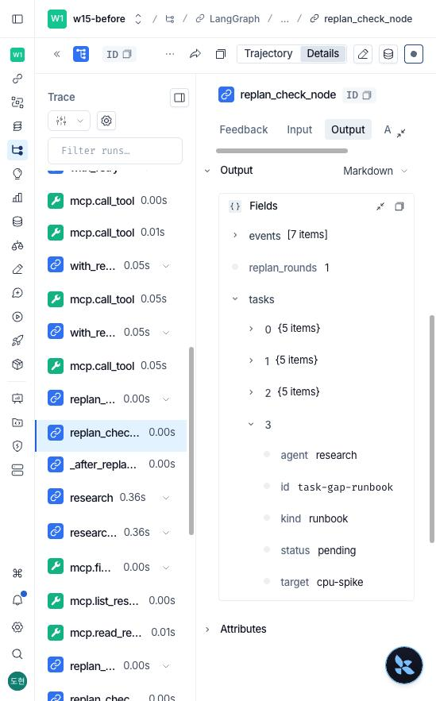
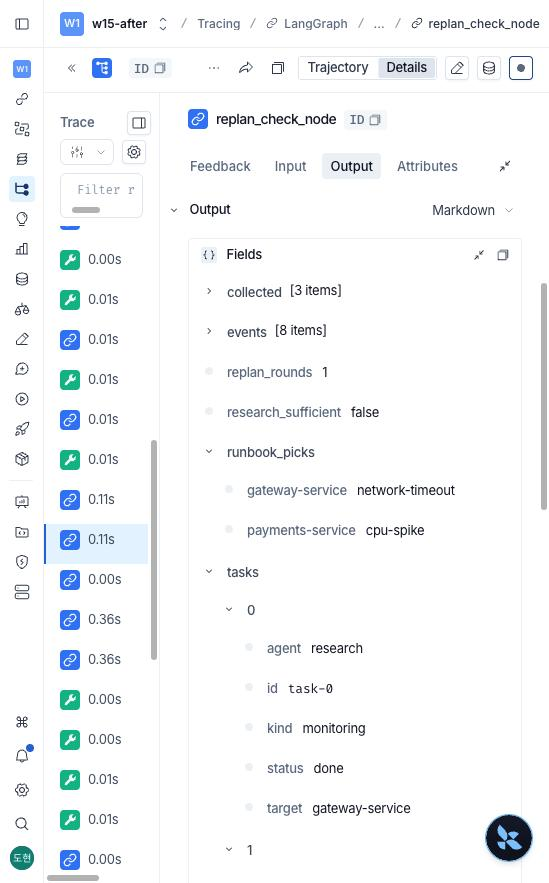
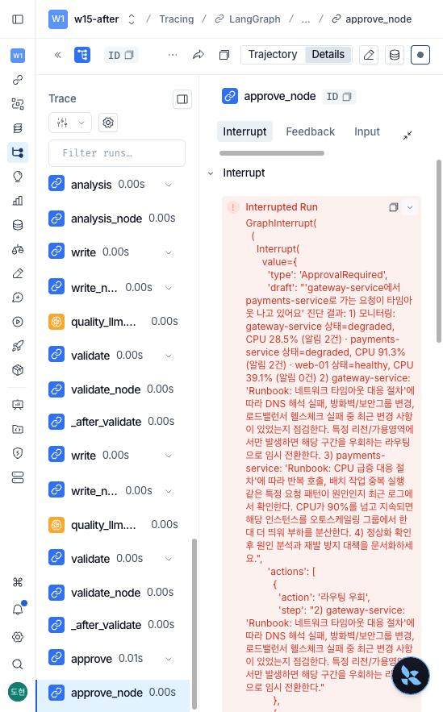
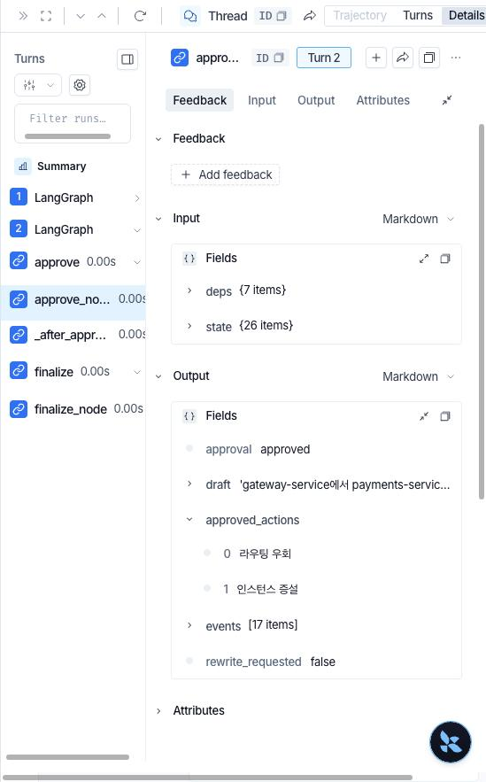
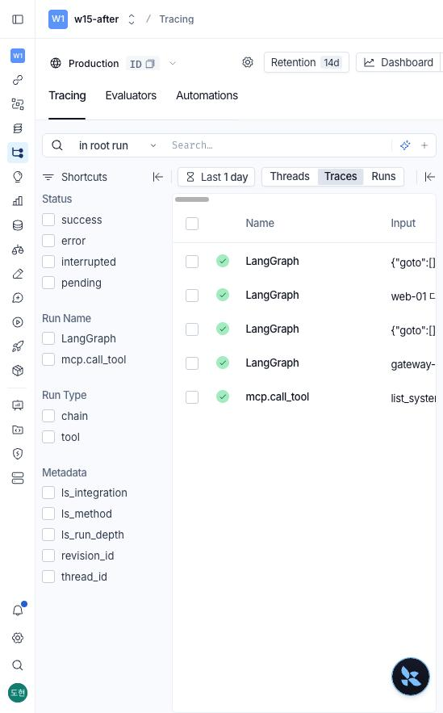

# 개선 전후 측정 결과

## 측정 조건

| 항목 | 값 |
| --- | --- |
| 질문 세트 | `eval/cases.jsonl` 26개(개발용 14, 평가용 12). 장애 질문 24개, 잡담 2개 |
| 정답 | 시스템별 runbook(`{"gateway-service": "network-timeout", ...}`), 매뉴얼이 없으면 `{}` |
| 모델 | `LLM_BACKEND=fake`(결정론, 비용 0) |
| 라우팅 | `--oracle-route`. fake 라우터가 회귀 질문 8개 중 7개를 잡담으로 보내 뒤 단계가 측정되지 않으므로 라우터만 정답으로 고정했습니다 |
| 반복 | 3회(장애 질문 72행). 지연은 장애 경로를 탄 행의 중앙값 |
| 승인 | 승인 요청이 오면 즉시 `approve` 또는 `reject`로 재개합니다. 사람이 기다린 시간은 지연에 들어가지 않습니다 |
| 같은 입력 | 모든 라벨이 같은 `cases.jsonl`을 씁니다. `before`와 `after-select`는 질문 2개를 더한 뒤 해당 커밋을 `git worktree`로 다시 꺼내 재측정했습니다 |

```bash
python eval/run_bench.py --label after-final --oracle-route --repeat 3
python eval/run_bench.py --label after-final-reject --oracle-route --repeat 3 --decision reject
python eval/run_bench.py --label after-reset-samethread --oracle-route --same-thread
python eval/report.py before after-select after-rag after-final after-final-reject
```

## 단계별 결과

| 지표 | before | after-select | after-rag | after-final | after-final-reject |
| --- | --- | --- | --- | --- | --- |
| runbook 정확 일치 | 0.5 | 0.875 | 1.0 | 1.0 | 1.0 |
| 매뉴얼 없음 거절 | 0.0 | 1.0 | 1.0 | 1.0 | 1.0 |
| 승인 없이 나간 위험 조치 | 72/72 | 57/57 | 66/66 | **0/66** | **0/0** |
| 승인 요청 수 | 0 | 0 | 0 | 54 | 87 |
| latency p50 (ms) | 731.2 | 730.9 | 794.5 | 799.3 | 800.2 |
| runbook 선택 p50 (ms) | 0.0 | 0.0 | 64.0 | 62.9 | 62.5 |
| retry 합계 | 1 | 1 | 1 | 1 | 1 |
| cost 평균 (usd) | 0.000563 | 0.00057 | 0.000585 | 0.000585 | 0.001008 |
| 기동 (s) | 0.66 | 0.65 | 10.22 | 8.39 | 6.86 |

- **before** 베이스 그대로입니다. 장애 질문 24개 중 12개만 맞았습니다. 틀린 12개는 여러 시스템의 알림을 합쳐 유형을 하나만 고른 경우(d04, d05, d06, t05), 정상 시스템의 한국어 증상 질문에 폴백 db-down이 나간 경우(d09, t08), 매뉴얼이 없어야 하는 질문에 db-down이 나간 경우(d08, d13, d14, t09, t10, t11)입니다. t07(web-01 DB 연결)은 정답이 db-down이라 폴백 덕에 우연히 맞았습니다.
- **after-select** 키워드 규칙은 그대로 두고 판단 근거만 시스템 단위로 나눴습니다. 0.5에서 0.875로 오른 몫이 시스템별 선택의 효과입니다. 남은 오답 3개(d09, t07, t08)는 정상인 web-01의 한국어 증상 질문이라 영어 키워드 규칙이 잡지 못했습니다. 폴백을 없앴기 때문에 우연히 맞던 t07은 이 단계에서 오히려 틀렸습니다.
- **after-rag** 같은 시스템별 선택 위에서 분류만 bge-m3 의미 검색으로 바꿨습니다. 남은 3개를 맞춰 1.0이 됐습니다. 대가로 기동이 약 10초, 질문당 선택이 약 63ms 늘었습니다.
- **after-final** 승인 노드, 턴 초기화, 시스템 목록 MCP화, 모듈 분리, 오류 격리를 모두 넣은 최종본입니다. runbook 선택은 그대로이고, 위험 조치가 든 답변 54건(3회 × 18건)이 모두 승인을 거쳐 나갔습니다.
- **after-final-reject** 모든 승인 요청을 거절했을 때입니다. 최종 답에 위험 조치가 하나도 남지 않았습니다. 승인 요청이 87회인 것은 첫 거절 뒤 다시 쓴 답에 다른 종류의 위험 조치가 들어와 한 번 더 물은 경우가 54건 중 33건 있었기 때문입니다. 재작성 때문에 평균 비용은 0.000585에서 0.001008 usd로 늘었습니다.
- 지연의 대부분은 research 노드의 고정 지연 `sleep(0.35)` 두 번입니다. fake 모델은 네트워크 호출이 없어 늘어난 60~70ms가 거의 그대로 runbook 선택 시간입니다.
- retry 합계 1은 베이스가 일부러 넣은 프로세스 첫 MCP 호출의 가짜 타임아웃 한 번입니다.

## 같은 대화로 연속 질문했을 때

장애 질문 24개를 한 `thread_id`로 차례로 보냈습니다.

| 지표 | 턴 초기화 전 (after-hitl-samethread) | 턴 초기화 후 (after-reset-samethread) |
| --- | --- | --- |
| runbook 정확 일치 | 0.292 | 1.0 |
| 승인 없이 나간 위험 조치 | 23/24 | 0/22 |
| 승인 요청 수 | 1 | 18 |
| retry 합계 | 24 | 1 |
| cost 평균 (usd) | 0.001714 | 0.000585 |

승인 노드를 위해 체크포인터를 붙이자, 같은 대화의 다음 질문이 이전 질문의 State 위에서 시작했습니다.
첫 질문에서 승인한 조치 기록이 남아 이후 질문은 다시 묻지 않고 위험 조치를 내보냈고,
`replan_rounds`가 이미 상한이라 runbook을 새로 고르지 않았으며, `retry_count`와 `cost_usd`가 턴을 넘어 쌓였습니다.
`agent/state.py`의 `turn_input()`이 State 선언의 모든 키를 빈 값으로 채운 입력을 만들어 이를 막습니다.

## 임계값 0.56의 근거

임계값은 개발용 질문만 보고 정했고, 평가용은 그 뒤에 한 번 돌렸습니다.

| 구분 | 정답이 있는 질문의 최저 점수 | 매뉴얼이 없어야 하는 질문의 최고 점수 |
| --- | --- | --- |
| 개발용 | 0.568 (log-service 알림 → disk-full) | 0.548 (web-01 오늘 점검 일정) |
| 평가용 | 0.568 (log-service 알림 → disk-full) | 0.541 (web-01 서버 정상인지 확인) |

양쪽 사이 간격이 0.02뿐입니다. 표현이 조금 바뀌면 판정이 뒤집힐 수 있으므로 임계값 하나로는 안정성을 보장하지 못합니다.

## 실모델 확인 (로컬 Ollama, 비용 없음)

`eval/ollama_smoke.py`로 qwen3:0.6b(fast) / qwen3:8b(quality)에서 두 질문을 끝까지 돌렸습니다. 원문은 `ollama_smoke.txt`입니다.

| 질문 | 결과 |
| --- | --- |
| cache-service 메모리 사용률이 계속 올라가요 (모두 거절) | memory-leak 선택 → 재시작 승인 요청 → 거절 → 재작성본에 배포 롤백이 들어와 다시 요청 → 거절 → 해당 문장 제거. 최종 답에 위험 조치 없음 |
| web-01 배포 담당자가 누구야? | 매뉴얼 없음 → 절차를 지어내지 않고 담당자 확인이 필요하다고 답함, 승인 요청 없음 |

두 질문 확인 뒤 장애 질문 24개(`cases.jsonl`의 장애 질문)를 개선 전 코드(`7ff9120`, `git worktree`)와 현재 코드로 한 번씩 돌렸습니다. 라우터는 정답으로 고정했습니다. 개선 후 실행은 질문 하나가 300초를 넘으면 끊고 `route=timeout`으로 남겼고(`--case-timeout 300`), 개선 전은 모두 300초 안에 끝났습니다. 원문은 `ollama-before.csv`, `ollama-after.csv`입니다.

```bash
LLM_BACKEND=ollama OLLAMA_FAST_MODEL=qwen3:0.6b OLLAMA_QUALITY_MODEL=qwen3:8b \
  python eval/run_bench.py --label ollama-after --oracle-route --repeat 1 --case-timeout 300 \
  --cases <장애 질문 24개 jsonl> --out eval/results/ollama-after.csv
```

| 지표 | 개선 전 | 개선 후 |
| --- | --- | --- |
| runbook 정확 일치(시간 초과는 오답) | 0.5 (12/24) | 0.667 (16/24) |
| 끝난 21개만 놓고 본 정확 일치 | 0.476 (10/21) | 0.762 (16/21) |
| 승인 없이 나간 위험 조치 | 12/12 | 0/11 |
| 승인 요청 | 0 | 9 |
| 300초 안에 끝나지 않은 질문 | 0 | 3 (d03, d08, t02) |
| 지연 중앙값 / 최대(끝난 질문) | 36.8초 / 92.8초 | 37.4초 / 77.0초 |
| runbook 선택 중앙값 | 0초 | 3.6초 |
| 기동 | 0.65초 | 8.74초 |
| 비용 평균(가상 단가) | 0.005853 usd | 0.005718 usd |

- CSV의 `exact` 열은 시간 초과 행도 기대값과 빈 결과를 그대로 비교합니다. 매뉴얼이 없어야 하는 d08은 시간 초과인데도 `exact=1`로 찍혀 있어, 위 표에서는 오답으로 다시 셌습니다. CSV 요약 출력의 0.708과 다른 이유입니다.
- 시간 초과 위치: d03, t02는 `write_node`의 qwen3:8b 스트림(`_chat_stream`), d08은 `analysis_node`의 qwen3:0.6b 호출(`_chat`)이었습니다. 어댑터에 생성 길이 상한이 없어 생성이 끝나지 않은 것으로 봅니다. 개선 전 실측에서는 없던 일인데, 프롬프트에 들어가는 사실이 늘어난 탓인지는 확인하지 못했습니다.
- 개선 후에도 틀린 5개 중 4개(d04, d05, d06, t05)는 두 시스템이 함께 나온 질문에서 한 시스템의 매뉴얼만 나온 경우입니다. t09(billing-service)는 high-latency가 골라졌는데, 실모델 어댑터가 모니터링 대상이 아닌 시스템을 auth-service로 바꾸는 빈틈과 같은 모양입니다. 두 시스템 질문의 원인은 확인하지 못했습니다.
- runbook 선택 3.6초는 bge-m3와 Ollama가 같은 기기에서 함께 돌아 생긴 값입니다. fake 측정의 63ms와 크게 다릅니다.
- 1회 측정이라 실모델의 흔들림은 반영하지 못했습니다.

## LangSmith 추적으로 본 개선 전후

같은 두 질문(d04 gateway 타임아웃, d09 web-01 디스크)을 개선 전 코드(`7ff9120`, `git worktree`로 꺼냄)와 현재 코드로 돌려
각각 `w15-before`, `w15-after` 프로젝트에 추적을 남겼습니다. 조건은 위 측정과 같습니다(fake, 라우터 정답 고정, 승인 요청은 즉시 승인).

```bash
LANGCHAIN_TRACING_V2=true LANGCHAIN_PROJECT=w15-after python eval/run_bench.py --label trace --oracle-route --cases <d04, d09만 담은 파일>
```

| 장면 | 개선 전 | 개선 후 |
| --- | --- | --- |
| `replan_check_node` 출력 | gap task 하나, `target: cpu-spike` | `runbook_picks`: gateway-service → network-timeout, payments-service → cpu-spike |
| `approve_node` | 없음 | 첫 추적에서 상태 `interrupted`, Interrupt 탭에 `ApprovalRequired` 초안과 조치 목록 |
| 재개 | 없음 | 같은 thread의 두 번째 턴. 트리에 approve → finalize만 있고 MCP 호출이 없음 |
| 한 질문의 실행 수 | 48 | 첫 추적 49 + 재개 6 |

재개 추적에 MCP 호출이 없다는 것은 `test_resume_does_not_repeat_tool_calls`가 확인하는 성질을 실제 실행 기록으로 다시 보인 것입니다.
개발용 14문항 전체도 `w15-ai-mini` 프로젝트에 남겼습니다(질문 14, 재개 10, 기동 시 `list_systems` 1, 합계 25).

| 개선 전 `replan_check_node` | 개선 후 `replan_check_node` |
| --- | --- |
|  |  |

| 승인 노드에서 멈춤 | 재개(같은 thread 두 번째 턴) | 추적 목록 |
| --- | --- | --- |
|  |  |  |

## 정상 시스템의 연쇄 장애 질문 (의존 시스템 조사)

web-01은 지표가 정상이고 알림이 없습니다. 그래서 "web-01 로그인하면 에러 페이지가 떠요"처럼 증상만 말하는 질문은
질문 문장으로도 runbook을 고르지 못해 "맞는 매뉴얼 없음"으로 끝났습니다. 원인 후보인 auth-service(p95 2.4s, 커넥션 풀 92%)가
조사 대상에 없었기 때문입니다.

### 의존 관계 데이터

`data/dependencies.json`에 1단계 의존만 적었고, MCP `get_dependencies(system_name)` Tool이 이를 `{"system_name", "depends_on"}`으로 돌려줍니다.

| 시스템 | 의존 대상 | 근거 |
| --- | --- | --- |
| web-01 | auth-service | 로그인과 세션 확인을 auth-service에 맡기는 웹 서버로 가정했습니다 |
| payments-service | cache-service | 결제 처리 중 캐시를 읽는 구조로 가정했습니다 |
| gateway-service | payments-service | gateway 알림의 `upstream timeout to payments-service`와 맞춥니다 |
| auth-service, cache-service, log-service | 없음 | 요청 경로에서 호출하는 대상을 두지 않았습니다 |

### 규칙

판단은 LLM이 아니라 `agent/dependency.py`의 `expansion_origins()`가 내립니다. 시스템이 정상인지는 모니터링 결과가 있어야 알 수 있으므로,
첫 조사 직후 `dependency` 노드에서 한 번만 실행합니다. 세 조건이 모두 맞을 때만 의존 대상을 모니터링 조사에 더합니다(`DependencyAdded`).

1. 질문에 이름이 나온 시스템이 healthy입니다.
2. 질문에 증상 표현(`에러|오류|실패|안 되|끊기|먹통|느려|지연|타임아웃`)이 있습니다.
3. 질문 문장으로 그 시스템의 runbook을 고르지 못했습니다.

더한 시스템은 자기 모니터링 상태와 알림으로 runbook을 고르고, 근거(`basis`)를 `dependency`로 남깁니다. 그 시스템에서 runbook을 찾으면
증상을 말한 정상 시스템은 원인이 설명됐으므로 "매뉴얼 없음"으로 남기지 않습니다. 답변에는 "web-01 지표는 정상이지만 의존 대상인
auth-service 지표가 저하 상태라 ..." 문장이 들어갑니다. 조건 3은 기존 t07("web-01 DB 연결이 안 돼요"), t08("web-01 응답이 느려졌어요") 때문에
넣었습니다. 둘 다 증상 표현이 있지만 정답이 web-01 자체 runbook이라, 조건 1, 2만 두면 auth-service의 high-latency가 섞여 틀립니다.

### 측정

새 질문 4개(`eval/cases_dependency.jsonl`)의 정답은 데이터로 정했습니다. web-01에는 알림이 없고 auth-service 알림이 high-latency에 맞으므로
모두 `{"auth-service": "high-latency"}`입니다. before는 변경 전 커밋(`49989fa`)을 `git worktree`로 꺼내 같은 질문 파일로 쟀습니다.

```bash
git worktree add --detach <임시 폴더> 49989fa
(cd <임시 폴더> && python eval/run_bench.py --label cascade-before --oracle-route --repeat 3 \
   --cases <이 저장소>/eval/cases_dependency.jsonl --out <이 저장소>/eval/results/cascade-before.csv)
python eval/run_bench.py --label cascade-after --oracle-route --repeat 3 --cases eval/cases_dependency.jsonl
python eval/run_bench.py --label after-dependency --oracle-route --repeat 3
python eval/report.py cascade-before cascade-after
```

| 지표 | cascade-before | cascade-after |
| --- | --- | --- |
| runbook 정확 일치 | 0.0 | 1.0 |
| 승인 없이 나간 위험 조치 | 0/0 | 0/12 |
| 승인 요청 수 | 0 | 12 |
| latency p50 (ms) | 430.1 | 1250.0 |
| runbook 선택 p50 (ms) | 63.8 | 101.7 |
| cost 평균 (usd) | 0.000368 | 0.000689 |

- before는 4문항 모두 web-01 "매뉴얼 없음"으로 끝났습니다. after는 auth-service의 high-latency를 골라 4문항 모두 맞혔습니다.
- high-latency runbook의 "로드밸런서에서 일시 제외"가 답에 들어가 승인 요청이 3회 × 4문항 = 12번 생겼고, 승인 없이 나간 위험 조치는 없습니다.
- 지연이 약 820ms 늘었습니다. 조사가 한 번에서 세 번(의존 시스템 모니터링, 이전에는 없던 runbook 조회)으로 늘어 research의 고정 지연 0.35s가 두 번 더 붙었기 때문입니다.
  runbook 선택 시간은 web-01 질문 문장과 auth-service 알림을 둘 다 분류해 64ms에서 102ms로 늘었습니다.
- 질문당 MCP 호출은 Tool 1회에서 3회(`get_monitoring_status` 2, `get_dependencies` 1)로, Resource는 0회에서 1회로 늘었습니다.

기존 26문항은 `after-dependency`로 다시 재서 `after-final`과 78행을 비교했습니다. 구조 열(id, rep, route, runbooks, replan_rounds,
validation_attempts, approval_requests, risky_total, risky_unapproved)이 모두 같고, 정확 일치 1.0, 승인 요청 54, 위험 조치 0/66, 평균 비용도 그대로입니다.
26문항 중 증상 표현이 있는 질문은 7개였고, 이름이 나온 정상 시스템이 있는 것은 t07, t08뿐이며 둘 다 조건 3에서 걸러졌습니다.
대신 이 두 질문은 분류를 한 번 더 해 지연이 10~50ms 늘었습니다.

### 한계

- 의존 데이터가 틀리면 엉뚱한 시스템을 원인으로 지목합니다. 이 파일은 실제 호출 관계를 수집한 것이 아니라 위 가정으로 손으로 적은 것이고,
  1단계만 보므로 auth-service 뒤의 DB 같은 2단계 원인은 찾지 못합니다.
- 의존 조사가 일어나는 질문은 MCP 호출과 조사 단계가 늘어 위처럼 느려집니다.
- 증상 판단은 키워드 규칙입니다. "web-01 접속이 이상해요"처럼 목록에 없는 표현은 의존 조사로 가지 않습니다. 조건 3은 분류기에 기대므로
  "web-01 로그인 요청이 실패해요"는 bge-m3가 db-down(0.572, 임계값 0.56)을 골라 web-01 자체 문제로 판정했고 의존 조사가 일어나지 않았습니다.
  두 문장은 측정 세트에 넣지 않고 점수만 따로 확인했습니다.
- 새 질문 4개는 모두 web-01 → auth-service 한 경로입니다. 현재 데이터에서 정상인 시스템이 web-01뿐이라 다른 경로는 측정하지 못했습니다.

## 단위 테스트

```bash
python -m pytest -m "not slow"   # 79개, 약 14초 (MCP 서버 프로세스 없이 FakeMCP)
python -m pytest -m slow         # 14개, 실제 bge-m3
```
